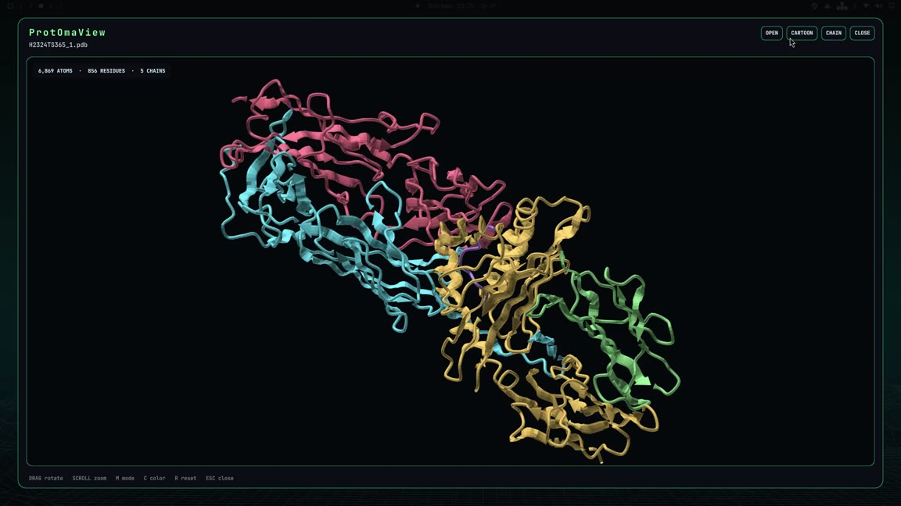
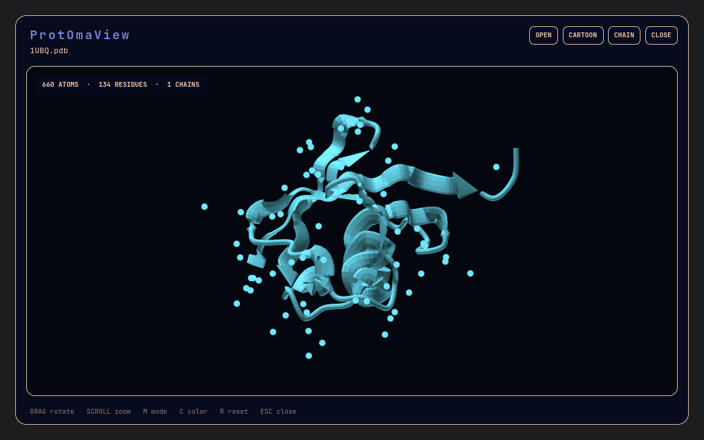

# ProtOmaView

**Who needs PyMOL when you have ProtOmaView?**

Sometimes you just want to see what’s in a structure file. Click the ribbon on your Omarchy bar, drop in a PDB or mmCIF file, and drag to turn the molecule. Follow one chain through the fold or press **M** to switch views. Your file stays on your machine, and the viewer works offline after installation.

[](https://samplebias.github.io/ProtOmaView/)

See a multichain structure rotate, zoom in on the fold, and follow the same coordinates through cartoon, backbone, wireframe, and atom views. [Watch the full demo (2:12)](https://samplebias.github.io/ProtOmaView/)

## Install and open

On Omarchy Quattro, run the following command and choose where to place the protein-ribbon icon when prompted. The plugin uses the QML and JavaScript runtime included with Quattro and needs no build step.

```sh
omarchy plugin add https://github.com/SampleBias/ProtOmaView.git --enable
```

Click the ribbon icon to open the viewer. If you need to place the icon on the bar later, run `omarchy bar put io.github.samplebias.protomaview --section right`.

## Take a first look at a prediction

Say you’ve just exported a model with two protein chains. Drop the file into ProtOmaView and check that the overlay reports **2 chains**. In the default chain colors, rotate the model to see where the chains meet. That gives you a quick first check that the file opens and contains the chains you expected.

If your prediction stores a local confidence score (pLDDT) in the B-factor field, press **C** until the button reads **BFACTOR**. In ProtOmaView, lower scores appear blue and higher scores trend toward red. You can spot a loop the predictor was unsure about before inspecting it more closely. Assessing the protein’s physical stability takes separate analysis. [How AlphaFold reports confidence](https://alphafold.ebi.ac.uk/faq)

## Try it with ubiquitin



1. Save the ubiquitin coordinate file to your computer. [Download 1UBQ.pdb from the Protein Data Bank](https://files.rcsb.org/download/1UBQ.pdb)
2. Open ProtOmaView and drop the file onto the viewer, or press **Ctrl+O** to select it. The first view shows the protein fold. Drag to see the helix from the side and scroll to zoom in on the sheet arrows.
3. Press **M** once to trace the backbone and again to see individual atoms. In atom view, press **C** to color them by element.

The preview uses the ubiquitin structure deposited by S. Vijay-Kumar, C. E. Bugg, and W. J. Cook. [RCSB Protein Data Bank entry 1UBQ](https://www.rcsb.org/structure/1UBQ)

## Viewing your own structures

Open a `.pdb`, `.ent`, `.cif`, or `.mmcif` file. Cartoon view draws helices, sheet arrows, and coils using the file’s secondary-structure records when available. For unannotated regions, it estimates secondary structure from the positions of neighboring alpha carbons. The overlay also shows ligands and counts the atoms, residues, and chains in the file.

| Control | Action |
| --- | --- |
| Drag / scroll | Rotate / zoom |
| **M** | Cycle through cartoon, backbone, atoms, and wireframe |
| **C** | Cycle through chain, element, and B-factor coloring |
| **R** or double-click | Reset the camera |
| **Ctrl+O** | Browse local structures |
| **Esc** | Close the file picker or viewer |

To open the viewer from a terminal, run `omarchy-shell shell summon io.github.samplebias.protomaview '{}'`. To open a particular structure, supply its absolute path in the summon payload.

```sh
omarchy-shell shell summon io.github.samplebias.protomaview '{"path":"/absolute/path/to/structure.cif"}'
```

## Update or remove

Review and apply an update to the installed plugin.

```sh
omarchy plugin update io.github.samplebias.protomaview
```

To uninstall, run the removal command and confirm at the prompt. Omarchy removes the installed plugin. Structure files you opened from elsewhere stay in their original locations.

```sh
omarchy plugin remove io.github.samplebias.protomaview
```

## Development

From a checkout, validate the manifest and lint the overlay.

```sh
omarchy plugin validate .
qmllint -I "$OMARCHY_PATH/shell" ProtOmaView.qml
```

The plugin runs inside the Omarchy shell with your user permissions. The file picker lists local folders, and the viewer reads the structure you open. Edits under `~/.config/omarchy/plugins/` hot-reload.

## License

[MIT](LICENSE)
